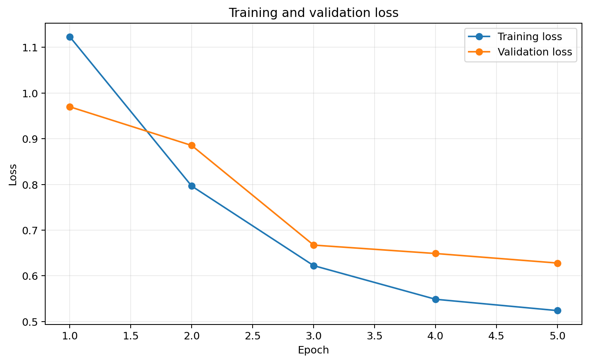
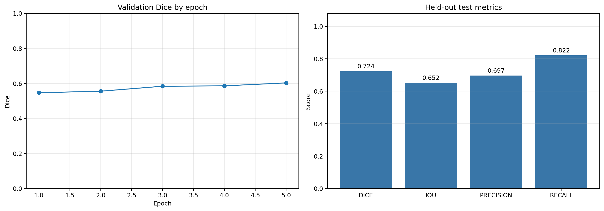
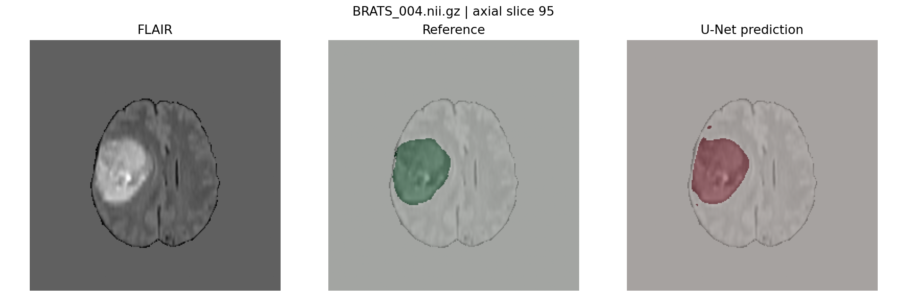

# Brain Tumor Segmentation with a 2D U-Net

A reproducible student project for segmenting the **whole tumor** in multimodal brain MRI. It uses a compact PyTorch U-Net on axial slices from the Medical Segmentation Decathlon (MSD) Task01 BrainTumour dataset.

## Scope and dataset choice

- **Task:** binary whole-tumor segmentation (all nonzero annotation labels combined).
- **Inputs:** the four co-registered MRI channels supplied per patient, ordered FLAIR, T1w, T1gd, T2w. The code expects channel-last NIfTI volumes shaped `[X, Y, Z, 4]`.
- **Model:** 2D U-Net, trained slice by slice to keep GPU memory and implementation complexity manageable.
- **Data:** MSD Task01 BrainTumour, a BraTS-derived collection with 484 labeled training cases and 266 unlabeled test cases. The project makes its own seeded 70/15/15 patient-level train/validation/test split from the labeled cases. The official unlabeled test cases are not used.
- **Subset:** the downloader defaults to 20 labeled patients for a practical first run. Increase `--cases` to fetch more, or set `--max-cases 0` during training to use all cases already downloaded. Small-subset results are for learning and pipeline verification, not benchmark results.

The dataset is available from the Medical Segmentation Decathlon download page and its public AWS mirror; the AWS Open Data Registry lists **CC BY-SA 4.0**, no-account access, and both archived and uncompressed data. The smaller downloader fetches just selected labeled cases. Do not redistribute the archive or derived dataset without following the license. Preserve attribution and share-alike terms for dataset-derived material.

**Attribution:** Simpson et al., *A large annotated medical image dataset for the development and evaluation of segmentation algorithms* (2019), and Antonelli et al., *The Medical Segmentation Decathlon* (2022), DOI: [10.1038/s41467-022-30695-9](https://doi.org/10.1038/s41467-022-30695-9). Also retain the dataset's supplied `LICENSE.txt` and cite the BraTS source papers listed in its dataset documentation when publishing work.

## Project structure

```text
brain-tumor-segmentation/
├── data/                         # downloaded data (not committed)
│   └── Task01_BrainTumour/
│       ├── imagesTr/
│       ├── labelsTr/
│       ├── imagesTs/
│       └── dataset.json
├── outputs/                      # local plots, metrics, and checkpoints
├── app.py                         # Streamlit inference app
├── scripts/
│   ├── download_subset.py
│   ├── explore_data.py
│   ├── train.py
│   ├── evaluate.py
│   ├── plot_results.py
│   └── predict.py
├── src/brain_tumor_seg/
│   ├── data.py
│   ├── metrics.py
│   └── model.py
├── requirements.txt
└── README.md
```

## 1. Set up the environment

Python 3.10 or 3.11 is recommended. A CUDA-enabled PyTorch install can speed up training; install the PyTorch build appropriate for your computer first if you need GPU support, then install the remaining requirements.

```powershell
py -3.11 -m venv .venv
.\.venv\Scripts\Activate.ps1
python -m pip install --upgrade pip
python -m pip install -r requirements.txt
```

On macOS/Linux, activate with `source .venv/bin/activate` instead.

## 2. Obtain the data

For the **small download**, the script inspects the official public tar archive through S3 byte-range requests and fetches only the selected image and mask contents (no AWS account or full archive download required):

```powershell
python scripts/download_subset.py --cases 20 --seed 42
```

This downloads paired image and mask files for selected cases and reports their actual combined size. Change `--cases` and `--seed` to choose a different reproducible subset. It reads the tar index remotely and requests byte ranges for selected files; it does not download the full archive. If S3 range access is unavailable, the fallback is downloading the full `Task01_BrainTumour.tar` archive from the [official MSD data page](https://medicaldecathlon.com/dataaws/), around 7.6 GB:

```powershell
aws s3 cp --no-sign-request s3://msd-for-monai/Task01_BrainTumour.tar data/Task01_BrainTumour.tar
New-Item -ItemType Directory -Force data | Out-Null
tar -xf data/Task01_BrainTumour.tar -C data
```

Both approaches produce `data/Task01_BrainTumour/` with `imagesTr/` and `labelsTr/`; the archive also has metadata and unlabeled `imagesTs/`. This project downloads no data implicitly beyond the explicit subset command. The 20-case subset is split by patient for training, validation, and held-out test; official `imagesTs` cases do not include labels and cannot be scored with Dice/IoU.

## 3. Explore and preprocess

```powershell
python scripts/explore_data.py --data data/Task01_BrainTumour
```

The script reports paired cases, raw label voxel counts, sample volume shapes, tumor voxels, and normalized channel statistics, then saves an example slice to `outputs/data_overview.png`. Preprocessing is deliberate and reproducible: each MRI channel is z-scored over nonzero brain voxels, clipped to `[-5, 5]`, and every nonzero label is combined into one tumor mask. Axial slices are read on demand; every tumor-containing slice and every fourth empty slice is used to reduce easy-background imbalance. The native 240×240 in-plane resolution is preserved rather than resized, avoiding extra interpolation and keeping the original detail.

## 4. Train

```powershell
python scripts/train.py --data data/Task01_BrainTumour --max-cases 0 --epochs 20
```

Options include `--batch-size`, `--lr`, `--seed`, `--workers`, and `--output`. Set `--max-cases 0` to use every locally downloaded patient. The random split is performed on complete patient volumes before slices are generated, so slices from one patient cannot cross the train, validation, and test boundaries. The seed and exact patient IDs are saved in `outputs/run/split.json`; the seed and arguments are also recorded in the best checkpoint. Validation Dice selects the saved checkpoint.

The objective is binary cross-entropy with logits plus soft Dice loss. Dice, IoU, precision, and recall use a 0.5 threshold and are averaged across sampled axial slices. Empty-reference/empty-prediction slices score 1 for Dice, IoU, and precision; recall is 1 when the reference slice contains no tumor. These conventions are saved with test metrics. A small subset or short run may perform poorly; results must be taken from your own run and should not be presented as clinical performance.

To evaluate an existing best checkpoint (including the first 5-epoch run) and save the exact split and all four metrics without retraining:

```powershell
python scripts/evaluate.py --data data/Task01_BrainTumour --checkpoint outputs/run/best_model.pt
```

This writes `outputs/run/test_metrics.json` and `outputs/run/split.json`. The test split is reconstructed from the saved checkpoint seed and case limit.

Create the portfolio plots from the saved training history and test metrics without retraining:

```powershell
python scripts/plot_results.py
```

This saves `results/training_curves.png` (training and validation loss across epochs) and `results/dice_scores.png` (validation Dice by epoch plus held-out test Dice, IoU, precision, and recall when available). Add these generated images to GitHub if you want them to appear in the repository; `results/` is not excluded by `.gitignore`.

## 5. Visualize predictions

```powershell
python scripts/predict.py --data data/Task01_BrainTumour --checkpoint outputs/run/best_model.pt
```

This saves `outputs/prediction.png` showing the FLAIR slice, its reference mask, and the model prediction. For a different case, pass `--case-index N`. The visualization chooses the axial slice with the largest reference tumor area; it is an illustrative labeled case, not a substitute for evaluating the held-out patient test set.

## 6. NeuroMask Lab: run the Streamlit app locally

Install the updated requirements, then launch the app:

```powershell
python -m pip install -r requirements.txt
python -m streamlit run app.py
```

In the app, upload `outputs/run/best_model.pt` and a four-channel `.nii` or `.nii.gz` MRI volume. Choose which MRI channel to display, move through axial slices, adjust the probability threshold, and run segmentation. The app explains the preprocessing, U-Net, and thresholding steps as you use it. It displays the selected MRI sequence, predicted whole-tumor mask, and probability map. Optionally upload the matching file from `labelsTr/` to compare the selected slice with ground truth and calculate slice Dice/IoU. It expects registered, skull-stripped BraTS-style volumes with channels ordered FLAIR, T1w, T1gd, T2w; it is not a general-purpose reader for arbitrary MRI scans.

## 7. Deploy on Streamlit Community Cloud

Community Cloud deploys from a GitHub repository. Push the project code, `requirements.txt`, and this README to a repository you control. Keep `data/`, patient scans, and `*.pt` checkpoints out of Git; the `.gitignore` already excludes them. In Community Cloud, create an app from that repository and set the entrypoint to `app.py`. The current app asks the viewer to upload a checkpoint and scan at runtime, so you do not have to commit model weights or MRI files. The app viewer needs a copy of `best_model.pt` to use the deployed model.

See the official [Community Cloud deployment guide](https://docs.streamlit.io/deploy/streamlit-community-cloud/deploy-your-app/deploy) and [dependency guide](https://docs.streamlit.io/deploy/streamlit-community-cloud/deploy-your-app/app-dependencies). Community Cloud uses `requirements.txt` to install Python packages; keep only one dependency manifest for the app.

## Metrics and interpretation

For a binary mask, Dice is `2 × intersection / (prediction pixels + reference pixels)` and IoU is `intersection / union`. Both range from 0 to 1, with larger values indicating more overlap. This implementation reports the unweighted average of per-slice metrics. For a stronger portfolio study, add per-patient volume metrics, repeat several seeds, compare against a simple baseline, and discuss the effects of 2D context and class imbalance.

## Example run and results

The plotted run used 20 labeled patients, a 14/3/3 patient-level train/validation/test split, 5 epochs, and CPU. Training loss decreased from `1.123` to `0.524`; validation loss decreased from `0.970` to `0.628`. Validation Dice rose from `0.547` at epoch 1 to `0.603` at epoch 5.

On the held-out split of 3 patients, the reported slice-averaged metrics were:

| Metric | Score |
|---|---:|
| Dice | 0.724 |
| IoU | 0.652 |
| Precision | 0.697 |
| Recall | 0.822 |

These are preliminary results from a small subset and only 5 epochs, not a robust benchmark. Metrics are averaged over sampled axial slices. Empty-reference/empty-prediction slices score 1 for Dice, IoU, and precision; recall is 1 when the reference slice contains no tumor. The held-out test set has only 3 patients, so these scores should be interpreted cautiously.

### Training curves



Both losses decreased over these five epochs. This shows improvement during this short run, but is not enough evidence to establish convergence or rule out overfitting.

### Validation Dice and held-out test metrics



### Example segmentation



This is a qualitative example from `BRATS_004`; it is not confirmed to be from the held-out test split. It follows the main tumor region and includes a few small isolated false-positive areas. One slice does not replace test-set evaluation.

## Limitations

This is an educational research prototype. It produces a 2D binary mask, does not preserve the separate tumor subregions, does not exploit 3D context, and is not validated for diagnosis or treatment. The 20-case subset is intentionally small. A fair headline result requires a clearly documented split, complete training details, and repeated runs; these preliminary metrics are not a robust benchmark or clinical performance claim.

## License

The source code in this repository is released under the [MIT License](LICENSE). This license applies to the project code only. The Medical Segmentation Decathlon BrainTumour data is **not** included in this repository and remains under its separate **CC BY-SA 4.0** terms. Follow the dataset's attribution and share-alike requirements when using or sharing dataset-derived material; the MIT license does not replace or override those terms.
